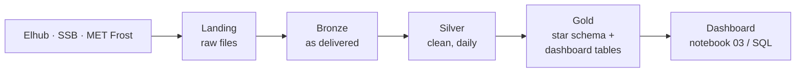

# DAT535 Group 24 – Norgespris and electricity use

Batch data pipeline (**PySpark**, **Medallion architecture**, **PostgreSQL**) for the course **DAT535 Data Engineering** at UiS, autumn 2026.

**Question:** has daily electricity use per household and per inhabitant changed after Norgespris started (1 October 2025), taking
temperature into account – and where (price area, county, municipality) is the change largest?



| Source | Data | How |
|---|---|---|
| Elhub Energy Data API | hourly consumption per municipality and customer group; Norgespris consumption per price area | API CSV exports (open) |
| data.elhub.no | metering points with Norgespris per municipality | CSV download (open) |
| SSB table 07459 | population per municipality, 1 January | PxWebApi v2 (open) |
| MET Frost API | weather stations and daily mean temperature | API (free client ID) |
| MET Seklima | daily mean temperature (fallback only) | manual CSV export |

## Status

| Layer | Status | Code |
|---|---|---|
| Landing + Bronze (schema `bronze`) | ✅ | `notebooks/01_bronze.ipynb` → `bronze_pipeline.py`, `bronze_to_postgres.py` |
| Silver (schema `silver`) | ✅ | `notebooks/02_silver.ipynb` → `silver_pipeline.py` |
| Gold (schema `gold`) + dashboard | ✅ | `notebooks/03_gold.ipynb` → `gold_pipeline.py` |
| CI/CD (lint, 65 tests, dev/prod/monthly workflows) | ✅ | `.github/workflows/`, `tests/` |

## Documentation

| Document | Read it when you want to … |
|---|---|
| [docs/architecture.md](docs/architecture.md) | understand **how the system is built and why**: context, data flow from the APIs into Gold, layers, design decisions, limitations |
| [docs/data-model.md](docs/data-model.md) | see **the tables of every layer**: ER diagrams, grain, keys, lineage, formulas |
| [docs/data-quality.md](docs/data-quality.md) | know **how correctness is checked**: reject rules, quality metrics, Gold checks, runbook |
| [docs/setup.md](docs/setup.md) | **install a new environment** (macOS / Ubuntu, PostgreSQL, `.env`, notebooks, GitHub runner, troubleshooting) |
| [docs/pipelines.md](docs/pipelines.md) | **run and operate** the pipeline: stages, workflows, branches, monitoring, recovery |
| `notebooks/01–03` | read **every line of code explained**, with results, quality evidence and the dashboard |

## Quick start

Full instructions: [docs/setup.md](docs/setup.md).

```bash
git clone https://github.com/aaamainorg/dat535-group24.git && cd dat535-group24
bash scripts/setup_env.sh && source ~/spark-env/bin/activate      # Python venv + Java check
psql -d postgres -v pw='choose-a-password' -f scripts/init_postgres.sql   # once (Ubuntu: sudo -u postgres psql …)
cp env.example .env                                                # then fill in FROST_CLIENT_ID, NORGESPRIS_PG_PASSWORD, the period
pytest -q tests/                                                   # 65 passed
python run_pipeline.py all                                         # bronze -> postgres -> silver -> gold (dev)
```

**Delta load** (default, `NORGESPRIS_LOAD_MODE=delta` in `.env`): the first run downloads the full files; every later run
downloads only the newest complete month and appends it to Bronze. `NORGESPRIS_LOAD_MODE=full` = whole files every run.
See [docs/pipelines.md](docs/pipelines.md#full-and-delta-load).

Is the result ready?
```sql
SELECT status, first_day, last_day, failed_checks FROM gold.publish_log ORDER BY logged_at DESC LIMIT 1;   -- published?
SELECT measure, adjusted_change_pct, adjusted_change_vs_business_pp, reliable
FROM gold.agg_norgespris_effect WHERE level = 'national';                                                  -- the answer
```

## Repository structure

```text
.
├── README.md                     # this page
├── docs/                         # architecture, data model, data quality, setup, pipelines
├── env.example                   # template for .env (settings + credentials) - copy to .env, never commit .env
├── requirements.txt              # Python packages
├── run_pipeline.py               # one entry point: python run_pipeline.py bronze | postgres | silver | gold | all
├── bronze_pipeline.py            # stage "bronze":   sources -> landing files            (generated from notebook 01)
├── bronze_to_postgres.py         # stage "postgres": landing files -> schema bronze      (generated from notebook 01)
├── silver_pipeline.py            # stage "silver":   schema bronze -> schema silver      (generated from notebook 02)
├── gold_pipeline.py              # stage "gold":     schema silver -> schema gold        (generated from notebook 03)
├── notebooks/                    # 01_bronze, 02_silver, 03_gold - every line explained, dashboard in 03
├── tests/                        # pytest: bronze, postgres, silver, gold (no database or internet needed)
├── scripts/
│   ├── setup_env.sh              # Python venv + Java (used by every workflow)
│   ├── init_postgres.sql         # one-time PostgreSQL setup: role, databases, schemas
│   └── manifest_summary.py       # Bronze run table for the GitHub Actions run page
└── .github/workflows/
    ├── norgespris-dev.yml        # push to dev_* branches / manual -> lint, tests, pipeline (dev)
    ├── norgespris-prod.yml       # push to main / manual          -> lint, tests, pipeline (prod, approval)
    └── pipeline.yml              # monthly schedule / manual      -> lint, tests, pipeline (prod)
```

Data is **not** stored in git: raw files go to `/tmp/norgespris-landing/<dev|prod>/`, tables to the PostgreSQL databases
`norgespris_dev` / `norgespris_prod`.

## Licences and credits

Elhub open data (NLOD) · Statistics Norway, table 07459 (CC BY 4.0) · Norwegian Meteorological Institute, Frost/Seklima (CC BY 4.0).
