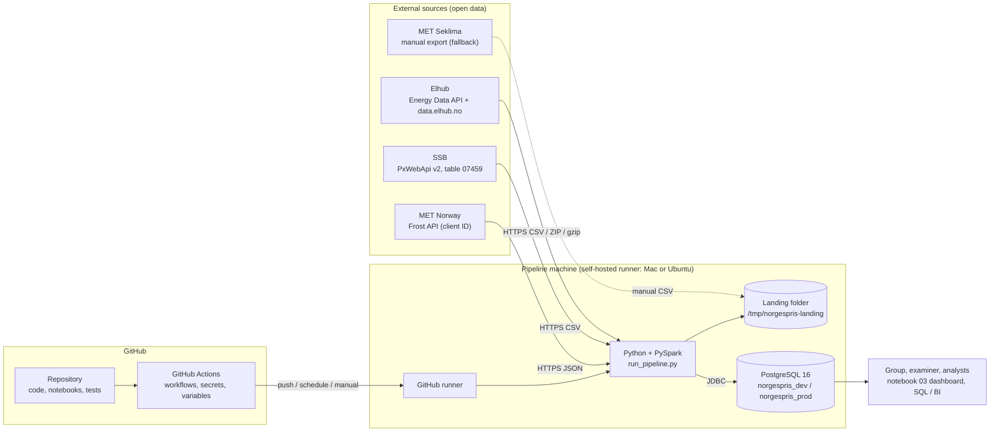
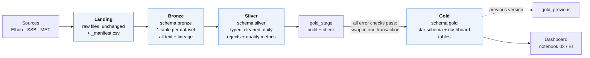
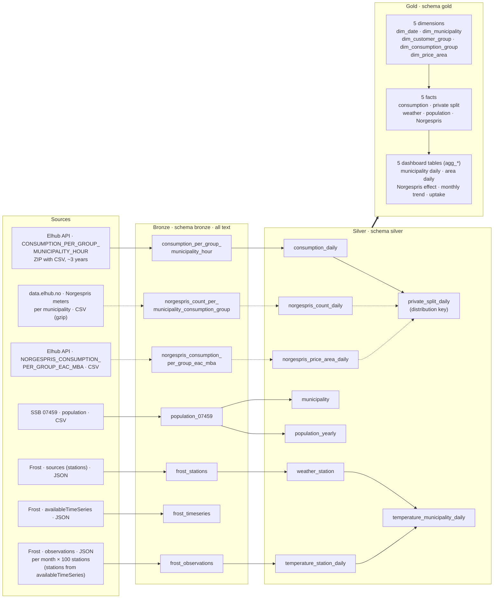

# System design

**DAT535 Group 24 – Norgespris and electricity use.**
This document describes how the system is built and why. Table-level details are in [data-model.md](data-model.md), quality rules in
[data-quality.md](data-quality.md), installation in [setup.md](setup.md) and operation in [pipelines.md](pipelines.md).

## Contents
1. [Purpose and scope](#1-purpose-and-scope)
2. [System context](#2-system-context)
3. [Architecture overview – Medallion layers](#3-architecture-overview--medallion-layers)
4. [End-to-end data flow](#4-end-to-end-data-flow)
5. [Responsibilities of each layer](#5-responsibilities-of-each-layer)
6. [Technology stack](#6-technology-stack)
7. [Environments](#7-environments)
8. [Key design decisions](#8-key-design-decisions)
9. [Quality and reliability](#9-quality-and-reliability)
10. [Performance and capacity](#10-performance-and-capacity)
11. [Security](#11-security)
12. [Known limitations and future work](#12-known-limitations-and-future-work)

---

## 1. Purpose and scope

**Question:** *Has daily electricity use per household and per inhabitant changed after Norgespris started (1 October 2025), adjusted for
temperature, and where (price area, county, municipality) is the change largest?*

| | |
|---|---|
| **What we build** | A batch pipeline in PySpark that collects open data from Elhub, SSB and MET, stores it in PostgreSQL in three layers (Bronze, Silver, Gold), and serves a temperature-adjusted before/after analysis. |
| **Consumers** | The project group and the examiner (notebook dashboard), analysts (SQL on the `gold` schema, any BI tool). |
| **Refresh** | Monthly (Elhub publishes a month a few days after it ends); can be run any time by hand. |
| **Out of scope** | Effects in individual households, causes such as EV charging or heating type, electricity prices, real-time processing. |

## 2. System context

Who and what the system talks to.

## 3. Architecture overview – Medallion layers

| Stage (`run_pipeline.py …`) | From → to | Code |
|---|---|---|
| `bronze` | sources → landing files | `bronze_pipeline.py` (notebook 01 §3) |
| `postgres` | landing files → schema `bronze` | `bronze_to_postgres.py` (notebook 01 §4–5) |
| `silver` | `bronze` → `silver` | `silver_pipeline.py` (notebook 02) |
| `gold` | `silver` → `gold_stage` → `gold` | `gold_pipeline.py` (notebook 03) |

The notebooks are the **source of the code**: every pipeline cell is copied 1:1 into the `.py` file that GitHub Actions runs, so the explained
code and the executed code are the same.

## 4. End-to-end data flow

From each source file or API call to the Gold tables. Dashed arrows are optional inputs (the pipeline runs without them).
Which Silver table feeds which Gold table is shown in [data-model.md §6](data-model.md#6-lineage-silver--gold).

**What happens along the way (short):**
1. **Landing** – files are stored as delivered (a ZIP is kept and also unpacked next to it; gzip *transfer* compression from data.elhub.no
   is undone on download), registered in `_manifest.csv` with SHA-256, size and header; a file with a known checksum is skipped. **Delta load** (default): after
   the first full load only the newest complete month of the time series is downloaded (Elhub month files, Frost months).
2. **Bronze** – the newest version of every file is loaded into one PostgreSQL table per dataset, **all columns as text**, plus
   `_source_file`, `_landing_run_id`, `_loaded_at`. A table is only reloaded when its landing files changed; in delta mode new month files are **appended**.
3. **Silver** – types (`try_cast`), local dates, newest version per key, rejects with a rule id, hourly → **daily**, old municipality codes
   matched to today's, temperature per municipality (own stations or county average), county name + price area, and the
   **distribution key** that splits *private* consumption into *household* and *cabin*.
4. **Gold** – Kimball star schema, heating degree days, temperature model fitted before 1 Oct 2025, expected vs actual after, control group
   (business). Built in `gold_stage`, checked against Silver, then published.

## 5. Responsibilities of each layer

| Layer | Storage | Contains | Changes the data? | History | Idempotent re-run |
|---|---|---|---|---|---|
| **Landing** | files in `/tmp/norgespris-landing/<env>/` | raw files exactly as delivered + manifest | no | every new file version kept (by run id) | yes – same checksum = skipped |
| **Bronze** | PostgreSQL schema `bronze` | one table per dataset, all text, lineage columns | no (only text + lineage) | newest version of each file + appended month files; `_load_log` / `_load_files` keep the load history | yes – unchanged files are not reloaded, a file is appended only once |
| **Silver** | schema `silver` | clean, typed, one row per key, daily grain; `rejects`, `quality_metrics` | yes: types, dedup, rejects, enrichment | `quality_metrics` appended per run; tables rebuilt | yes – full rebuild from Bronze |
| **Gold** | schema `gold` (+ `gold_stage`, `gold_previous`) | dimensions, facts, dashboard tables; `publish_log`, `check_results` | yes: modelling, aggregation, analysis | previous version in `gold_previous`; logs appended | yes – full rebuild, published only if checks pass |

## 6. Technology stack

| Part | Technology | Why |
|---|---|---|
| Processing | **PySpark 4** (local mode), DataFrame API + **Spark SQL** | course requirement; the same code scales to a cluster; Spark SQL makes Gold readable |
| Storage | **PostgreSQL 16** via Spark JDBC (driver `org.postgresql:postgresql:42.7.4`) | one database for all layers, inspectable with SQL/BI tools, transactions for safe publishing |
| Ingestion | Python standard library (`urllib`, `zipfile`, `gzip`, `hashlib`) | no extra dependencies for downloading |
| Orchestration | `run_pipeline.py` (stages) + **GitHub Actions** on a **self-hosted runner** | runs where the database is; schedule + manual runs + CI in one place |
| Tests and lint | **pytest** (local Spark, no database), **ruff** | fast checks before every pipeline run |
| Analysis | Jupyter notebooks, pandas, matplotlib | explained code + dashboard in one place |
| Configuration | `.env` locally, GitHub **secrets** and **variables** in CI | no credentials in code |

## 7. Environments

| | dev | prod |
|---|---|---|
| Selected by | `NORGESPRIS_ENV=dev` (default) | `NORGESPRIS_ENV=prod` |
| Landing folder | `/tmp/norgespris-landing/dev` | `/tmp/norgespris-landing/prod` |
| Database | `norgespris_dev` | `norgespris_prod` |
| Period | `NORGESPRIS_DEV_START_MONTH` / `_END_MONTH` | `NORGESPRIS_PROD_START_MONTH` (2024-01) / `_END_MONTH` (empty = up to last complete month) |
| Triggered by | push to a `dev_*` branch, manual | push to `main` (after review), monthly schedule, manual |
| GitHub environment | `dev` | `main` (required reviewers) |

Both environments run the **same code**; only these settings differ. See [pipelines.md](pipelines.md) for the workflows.

## 8. Key design decisions

| # | Decision | Why | Alternative we did not choose |
|---|---|---|---|
| D1 | Raw files land in `/tmp/norgespris-landing`, Bronze is a **PostgreSQL schema** | Bronze must be queryable; raw files are short-lived input that can be downloaded again | Parquet files as Bronze (harder to inspect, no SQL for the group) |
| D2 | Bronze keeps **every column as text** | Bronze must not change data; a bad value never stops the load; typing happens in Silver with `try_cast` | typed Bronze (one bad value would fail the load) |
| D3 | **Delta load**: first run = Elhub's whole ~3-year API export, later runs = only the newest month from Elhub's month file on data.elhub.no (`…-all-en-YYYY-MM-00.csv`); time-series tables in Bronze are **appended** | the API `.csv` export accepts no date filter (HTTP 400), but Elhub publishes the same dataset per month; one month instead of three years per run | full export every run (`NORGESPRIS_LOAD_MODE=full` still possible); monthly JSON API calls (other format, much slower) |
| D4 | Silver at **daily grain** | the question is per day; 28 M hourly rows → ~1.1 M daily rows makes every later step faster | hourly Silver (hourly detail stays in Bronze) |
| D5 | Dates are **Norwegian local dates** (Elhub as written; Frost converted from UTC to `Europe/Oslo`) | a "day" means a Norwegian day for consumption and temperature alike | UTC days (would shift consumption by 1–2 hours) |
| D6 | **Rejects table** with rule id instead of dropping rows silently | every removed record can be explained and counted | filtering without a trace |
| D7 | **Distribution key** private → household + cabin in Silver | consumption only has `private`, Norgespris has `household`/`cabin`; the key uses Elhub's own meter counts and use per meter | joining the groups directly (impossible: different categories) |
| D8 | Gold as a **Kimball star schema** + pre-aggregated `agg_*` tables | simple, fast SQL for any question; dashboard reads small tables | one wide table (repeats data, hard to extend) |
| D9 | Temperature adjustment with **heating degree days** and a model fitted **before** the start | removes the effect of a colder/warmer winter; standard Norwegian method (base 17 °C) | raw before/after comparison (misleading, different seasons) |
| D10 | Gold built in `gold_stage`, **published by a schema swap in one transaction** only if all error checks pass | consumers never see half-built or wrong data; previous version kept in `gold_previous` | writing directly into `gold` |
| D11 | **Full rebuild** of Silver and Gold every run (also in delta mode) | small data (minutes), always consistent, simple; Silver's newest-version-per-key handles months loaded twice into Bronze | incremental Silver/Gold (more code, more failure modes) |
| D12 | Notebook cells are the source of the `.py` files | the code the examiner reads is the code that runs | separate code and notebooks (they drift apart) |

## 9. Quality and reliability

| Mechanism | Where | Details |
|---|---|---|
| Checksums, schema change flag, manifest | Landing | [data-quality.md §2](data-quality.md#2-landing-and-bronze) |
| Load log, lineage columns | Bronze | [data-quality.md §2](data-quality.md#2-landing-and-bronze) |
| Reject rules (`CONS-01`, `SSB-01`, …), quality metrics per run, unique keys | Silver | [data-quality.md §3](data-quality.md#3-silver) |
| Checks G-01 … G-12 against Silver, publish gate, publish log | Gold | [data-quality.md §4](data-quality.md#4-gold) |
| Unit tests (65) + lint before every pipeline run | CI | [pipelines.md](pipelines.md) |
| A stage that fails stops the run (Gold is never built from a failed Silver) | `run_pipeline.py` | [pipelines.md](pipelines.md) |

## 10. Performance and capacity

Measured on our data (2024-01 → 2026-11, 357 municipalities):

| Item | Size / time |
|---|---|
| Hourly consumption in Bronze | ≈ 28 M rows |
| `silver.consumption_daily` | ≈ 1.1 M rows (357 municipalities × ~1 050 days × 3 customer groups) |
| `silver.temperature_station_daily` | ≈ 0.9 M rows (≈ 2 300 stations) |
| Silver run | ≈ 10 min (laptop) |
| Gold run | ≈ 1.5 min at full size |
| Peak RAM of Spark's Java process (Gold) | 2.5 GB with `spark.driver.memory=2g`, 1.5 GB with `1g` (same speed) |

Tuning that was **measured**, not assumed (details in notebooks 02 §5.3 and 03 §9):
* JDBC reads with `fetchsize` and **one partition per month** (`predicates`) instead of one big read.
* **Broadcast joins** for the small dimension tables.
* **`localCheckpoint()`** for Gold tables that are read by several steps: Gold went from 148 s to 41 s on test data (the
  long query plans, not the data, were the problem).
* `NORGESPRIS_SPARK_DRIVER_MEMORY` (default `2g`, `1g` on small machines) – the heap size decides the RAM; keeping tables on disk did not help.

**Scaling:** the code is plain Spark; on a cluster the same jobs would run unchanged. The limits today are the single machine and
JDBC writes to one PostgreSQL server (most of the run time).

## 11. Security

* Credentials (`FROST_CLIENT_ID`, `NORGESPRIS_PG_PASSWORD`) only in `.env` (git-ignored) and GitHub **secrets** – never in code or notebooks.
  Logs show the names of loaded keys, never their values.
* The runner is a **self-hosted** machine: the workflows have **no `pull_request` trigger**, so code from a fork can never run on it.
* `permissions: contents: read` in every workflow; prod runs need an approval (GitHub environment `main`).
* PostgreSQL role `norgespris` owns only the two project databases.

## 12. Known limitations and future work

| Limitation | Consequence | Possible improvement |
|---|---|---|
| Elhub's API serves only ~3 rolling years; Silver is rebuilt each run | in **full** mode the "before" period slowly shrinks (from spring 2027 the model has fewer pre-start days). In **delta** mode the Bronze table keeps old months as long as no full reload happens (a full reload, e.g. after `/tmp` was cleaned, starts again from the ~3-year export) | keep old days in Silver (append missing dates), or freeze the baseline model |
| Municipality → price area via the county's **main** price area | a few border municipalities are in the wrong price area | municipality-level reference list (NVE) as a Bronze reference file |
| Household/cabin is an **allocation** of private | household-only changes inside one municipality cannot be seen | report `kwh_per_private_meter` (measured) next to household; better key if Elhub publishes household data per municipality |
| Linear HDD model, no holidays/daylight/price terms | some variation unexplained (R² shown) | add weekday/holiday terms, seasonal models |
| Other changes at the same time (prices, EVs, heat pumps) | we show change **after** Norgespris, not proof of its **effect** | business control group already included; more controls (price data) |
| Single machine; delta only for landing and Bronze | fine for this volume | incremental Silver/Gold, cluster, partitioned Parquet for Silver |

---
*Related:* [data-model.md](data-model.md) · [data-quality.md](data-quality.md) · [setup.md](setup.md) · [pipelines.md](pipelines.md) · notebooks `01_bronze`, `02_silver`, `03_gold`.
