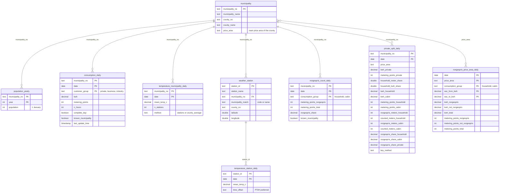
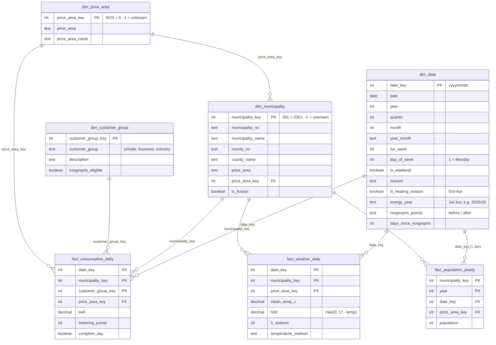
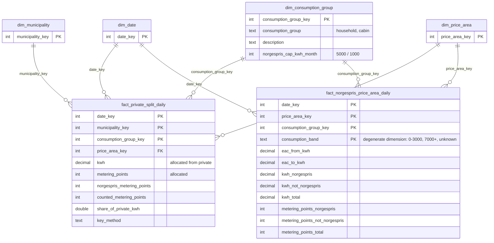
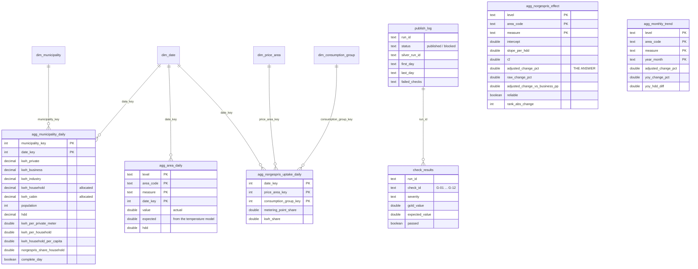
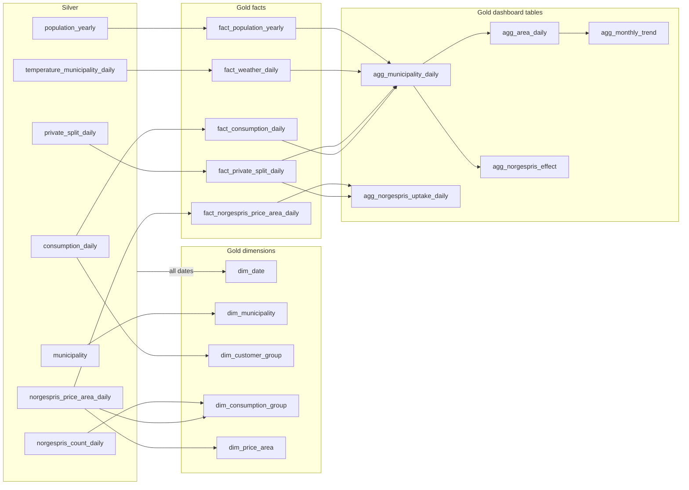

# Data model

The data model of every layer: what one row means (**grain**), the **keys**, how tables relate, and how the data moves from layer to layer.
The *why* behind the model is in [architecture.md](architecture.md); quality rules are in [data-quality.md](data-quality.md).

## Contents
1. [Overview – one model per layer](#1-overview--one-model-per-layer)
2. [Landing (files)](#2-landing-files)
3. [Bronze (schema `bronze`)](#3-bronze-schema-bronze)
4. [Silver (schema `silver`)](#4-silver-schema-silver)
5. [Gold (schema `gold`) – Kimball star schema](#5-gold-schema-gold--kimball-star-schema)
6. [Lineage Silver → Gold](#6-lineage-silver--gold)
7. [Measures and formulas](#7-measures-and-formulas)
8. [Naming conventions](#8-naming-conventions)

---

## 1. Overview – one model per layer

| Layer | Modelling style | Grain | Keys | Types |
|---|---|---|---|---|
| Landing | files + manifest | one file per dataset (and per month × station group for Frost) | `run_id` in the file name, SHA-256 | as delivered |
| Bronze | **source-shaped**: one table per dataset, columns as in the file | as in the source (hour, day, station, …) | none enforced (raw) | all **text** + 3 lineage columns |
| Silver | **normalised by entity**, cleaned | mostly **municipality × day** | natural keys (`municipality_no`, `date`, …), unique by test | typed (`date`, `decimal`, `int`, …) |
| Gold | **dimensional (Kimball)**: dimensions + facts + aggregates | municipality × day × group (facts) | integer surrogate/smart keys, PK + FK constraints in PostgreSQL | typed, additive measures in facts |

## 2. Landing (files)

```text
/tmp/norgespris-landing/<dev|prod>/
├── _manifest.csv                                  # one row per file seen (see columns below)
├── _gold_summary.md                               # result of the last Gold run (published / blocked + checks)
├── _incoming/<run_id>/                            # downloads arrive here; removed once stored
├── _manual/<source>/<dataset>/                    # manual exports (e.g. Seklima) are picked up from here
└── <source>/<dataset>/<period>/<run_id>__<file>   # stored files, never overwritten
    e.g. elhub/consumption_per_group_municipality_hour/snapshot/20261112T232839993654Z__consumption_per_group_municipality_hour.zip
         + …_unzipped/part-00000-….csv             # a ZIP is also unpacked next to it
         met/frost_observations/2025-10/<run_id>__frost_obs_2025-10_l<layout>_g00.json   # month × group of 100 stations
```

`period` = `snapshot` for whole exports, `YYYY-MM` for monthly Frost files, `manual` for files from `_manual/`.

**`_manifest.csv`** (also loaded as `bronze.manifest`):

| Column | Meaning |
|---|---|
| `run_id` | UTC timestamp of the ingestion run, e.g. `20261112T232839993654Z` |
| `env`, `source`, `dataset`, `period` | what and where |
| `origin` | download URL, or `_manual/<source>/<dataset>` for a manual file |
| `original_filename`, `landing_path` | name as delivered, path where stored |
| `ingested_at_utc`, `size_bytes`, `sha256` | when, how big, checksum (of the content; for a ZIP: of the files inside) |
| `header`, `schema_status` | first line of a CSV; `first_file` / `ok` / `changed` compared with the previous file |
| `status` | `ingested`, `skipped_duplicate`, `no_data`, `warning: …`, `failed: …` |

## 3. Bronze (schema `bronze`)

One table per dataset, **columns exactly as in the source file, all as text**, plus three lineage columns. Bronze has no keys or
relations on purpose: it keeps the data as delivered; Silver decides what a valid record is.

```mermaid
erDiagram
    consumption_per_group_municipality_hour {
        text START_TIME "local time with offset, hourly"
        text MUNICIPALITY_NUMBER "e.g. 301, 0 = unknown"
        text NAME
        text CONSUMPTION_GROUP "private, business, industry"
        text QUANTITY_KWH
        text METERING_POINT_COUNT
        text LAST_UPDATE_TIME
    }
    norgespris_consumption_per_group_eac_mba {
        text START_TIME "daily"
        text PRICE_AREA "NO1-NO5"
        text CONSUMPTION_GROUP "household, cabin"
        text ESTIMATED_ANNUAL_CONSUMPTION_FROM "band"
        text ESTIMATED_ANNUAL_CONSUMPTION_TO "band"
        text QUANTITY_KWH_NORWAY_PRICE
        text QUANTITY_KWH_NOT_NORWAY_PRICE
        text METERING_POINT_COUNT
    }
    norgespris_count_per_municipality_consumption_group {
        text DATE
        text MUNICIPALITY_NUMBER
        text CONSUMPTION_GROUP "Household, Cabins and holiday properties"
        text COUNT_NORWAYPRICE "meters with Norgespris"
        text COUNT "all meters"
    }
    population_07459 {
        text Region_region "column 'Region - region': K-3101 - K-3101 Halden"
        text year_columns "one column per year: 'Personer1 - Personer 2024 - 2024'"
    }
    frost_stations {
        text id "SN18700"
        text name
        text municipalityId
        text geometry "JSON"
    }
    frost_timeseries {
        text sourceId
        text elementId
        text timeOffset
    }
    frost_observations {
        text sourceId "SN18700:0"
        text referenceTime "UTC"
        text observations "JSON list"
    }
    lineage_columns_on_every_table {
        text _source_file "landing file"
        text _landing_run_id "run that stored the file"
        timestamp _loaded_at "when loaded into PostgreSQL"
    }
```



Bookkeeping tables: **`bronze.manifest`** (the landing manifest, replaced each run) and **`bronze._load_log`** (one row per dataset load:
dataset, table, status, fingerprint of the landing files, rows, `loaded_at` – appended, so the history stays).

## 4. Silver (schema `silver`)

Clean, typed tables. **`municipality_no`** (4 characters, e.g. `0301`) is the common key; `silver.municipality` is the reference
(today's municipalities from SSB, old codes are mapped to today's). Dates are **Norwegian local dates**.



| Table | Grain (one row per …) | Built from | Notes |
|---|---|---|---|
| `municipality` | municipality | `bronze.population_07459` + `COUNTIES` | name after the last code in SSB's text; county name + main price area |
| `population_yearly` | municipality × year | `bronze.population_07459` (wide → long) | population on 1 January |
| `consumption_daily` | municipality × day × **customer group** | `bronze.consumption_per_group_municipality_hour` | newest version per hour, summed to the local day; `complete_day` = 23–25 hours |
| `weather_station` | station | `bronze.frost_stations` | municipality matched by code, else by unique name |
| `temperature_station_daily` | station × day | `bronze.frost_observations` | UTC → `Europe/Oslo` date; `PT0H` series first |
| `temperature_municipality_daily` | municipality × day | the two above + `municipality` | average of own stations, else county average |
| `norgespris_price_area_daily` | day × price area × **consumption group** × band | `bronze.norgespris_consumption_per_group_eac_mba` | optional input |
| `norgespris_count_daily` | municipality × day × **consumption group** | `bronze.norgespris_count_per_municipality_consumption_group` | optional input; group names standardised |
| `private_split_daily` | municipality × day | `consumption_daily` (private) + the two Norgespris tables + `municipality` | **distribution key** private → household + cabin, see [§7](#7-measures-and-formulas) |
| `rejects` | one rejected record | all cleaning steps | `run_id, dataset, rule_id, record` (JSON) – replaced each run |
| `quality_metrics` | run × table × metric | all steps | `run_id, measured_at, table_name, metric, value` – **appended** |

**Customer group vs consumption group.** The consumption file has *customer* groups (`private`, `business`, `industry`); the Norgespris files
have *consumption* groups (`household`, `cabin`). `private` = `household` + `cabin`, so they are never joined directly – the split table connects them.

## 5. Gold (schema `gold`) – Kimball star schema

Business process: **daily electricity consumption of Norwegian municipalities**. Dimensions are **conformed** (shared by all facts), so
facts at different grains can be combined ("drill across") on `date_key` + `municipality_key`. All facts store only **additive** numbers;
ratios are calculated in the aggregate tables. PostgreSQL enforces the primary and foreign keys after every publish.

### 5.1 Star 1 – consumption, weather and population (measured)



### 5.2 Star 2 – Norgespris: household and cabin



(The dimensions in star 2 are the same tables as in star 1 – only their keys are repeated here.)

### 5.3 Dashboard tables (`agg_*`) and logs

The aggregate tables are pre-computed answers for the dashboard. They are derived from the facts, so they repeat some numbers on purpose
(read-optimised); `level` is `national`, `price_area`, `county` or (in `agg_norgespris_effect` only) `municipality`.



### 5.4 Keys and history

| Key | Rule | Why |
|---|---|---|
| `date_key` | `yyyymmdd` as integer (`20251001`) | readable, sorts like a date |
| `municipality_key` | municipality number as integer (`0301` → `301`); `-1` = unknown | stable between runs (a full rebuild gives the same keys), so saved dashboard filters keep working |
| `customer_group_key`, `consumption_group_key` | fixed 1, 2, 3 for known groups; a new group from Elhub gets 100, 101, … | a new group never breaks the pipeline |
| `price_area_key` | the digit (`NO3` → 3); `-1` = unknown | stable |
| History | type 1 (current state) for municipalities: Silver maps old codes to today's municipalities | every day is reported in today's municipality structure |

Schemas around Gold: **`gold_stage`** (build area, emptied every run), **`gold`** (published), **`gold_previous`** (the version before).

## 6. Lineage Silver → Gold



`agg_area_daily`, `agg_norgespris_effect` and `agg_monthly_trend` are built through four intermediate views in Spark
(`v_area` → `v_long` → `v_model` → `v_daily`), explained in notebook 03 §5.3.

## 7. Measures and formulas

**Distribution key (Silver, `private_split_daily`).** For municipality *m* in price area *a* on day *d*:

| Symbol | Meaning | Source |
|---|---|---|
| `s(m)` | household meters ÷ (household + cabin meters), averaged over all days – one constant per municipality | `norgespris_count_daily` (fallback: price area) |
| `ih(a,d)`, `ic(a,d)` | kWh per household meter and per cabin meter that day | `norgespris_price_area_daily` (fallback: same calendar month) |
| household share of private kWh | `s·ih / (s·ih + (1−s)·ic)` | |
| `kwh_household` | private kWh × household share | |
| `kwh_cabin` | private kWh − `kwh_household` (so household + cabin = private exactly) | |

**Heating degree days:** `hdd = max(0, 17 − mean temperature °C)`.

**Measures in the analysis** (all per day):

| Measure | Formula | Measured / allocated |
|---|---|---|
| `kwh_per_private_meter` | private kWh ÷ private meters | measured |
| `kwh_per_household` | household kWh ÷ household meters | allocated |
| `kwh_household_per_capita` | household kWh ÷ population | allocated |
| `kwh_per_cabin` | cabin kWh ÷ cabin meters | allocated |
| `kwh_all_per_capita` | all kWh ÷ population | measured |
| `kwh_per_business_meter` | business kWh ÷ business meters (control group – no Norgespris) | measured |

**Temperature-adjusted change** (`agg_norgespris_effect`), per area and measure:
1. fit `value = a + b·hdd` on all complete days **before** 1 Oct 2025 (`regr_intercept`, `regr_slope`, `regr_r2`);
2. `expected = a + b·hdd` for every day **after** the start, with that day's real temperature;
3. `adjusted_change_pct = 100 · (Σ actual / Σ expected − 1)`;
4. `adjusted_change_vs_business_pp` = adjusted change − business adjusted change (same area);
5. `reliable` = ≥ 180 days before, ≥ 28 days after and R² ≥ 0.3.

## 8. Naming conventions

| Thing | Convention | Example |
|---|---|---|
| Bronze tables | the dataset name from the source registry (`SOURCES` in `bronze_pipeline.py`) | `bronze.population_07459` |
| Silver tables | entity + grain, snake_case | `silver.temperature_municipality_daily` |
| Gold | `dim_` dimension, `fact_` fact, `agg_` dashboard table | `gold.fact_consumption_daily` |
| Keys | `<entity>_key` in Gold, natural `<entity>_no` / `_id` in Silver | `municipality_key`, `municipality_no` |
| Lineage / technical columns | leading underscore | `_landing_run_id` |
| Units in names | `kwh`, `_c` (°C), `_pct` (percent), `_pp` (percentage points) | `adjusted_change_pct` |
