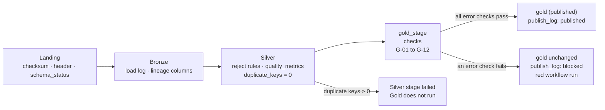

# Data quality

How we make sure the data is complete and correct in every layer, where the evidence is stored, and what to do when a check fails.
Overview of the layers: [architecture.md](architecture.md) · tables: [data-model.md](data-model.md) · running and monitoring: [pipelines.md](pipelines.md).

## Contents
1. [Principles](#1-principles)
2. [Landing and Bronze](#2-landing-and-bronze)
3. [Silver](#3-silver)
4. [Gold](#4-gold)
5. [Tests in CI](#5-tests-in-ci)
6. [Where to look – useful queries](#6-where-to-look--useful-queries)
7. [When something fails – runbook](#7-when-something-fails--runbook)

---

## 1. Principles

| Principle | How |
|---|---|
| **Never lose data silently** | Bronze keeps every column as text; Silver moves bad records to `silver.rejects` with a **rule id** instead of dropping them; unknown municipalities are kept (`known_municipality = false`, Gold key −1). |
| **Measure every run** | `silver.quality_metrics` and `gold.check_results` are **appended** each run, so this run can be compared with the previous one. |
| **Reconcile between layers** | Gold checks compare totals and row counts with Silver *inside PostgreSQL* (what was really stored). |
| **Stop bad data at the gate** | A failed stage stops the run; Gold is only published when every *error* check passes. |
| **Prove the grain** | every Silver and Gold table has a defined key; duplicates are counted (`duplicate_keys` must be 0) and in Gold enforced by primary keys. |



## 2. Landing and Bronze

| Check | Where | What happens |
|---|---|---|
| **SHA-256 of the content** (for a ZIP: the files inside) | `_manifest.csv` | a file identical to an earlier one → `skipped_duplicate`, not stored again |
| **Header compared with the previous file** | `_manifest.csv` → `schema_status` | `first_file` / `ok` / `changed` – a schema change is kept and flagged for Silver |
| **Download status** | `_manifest.csv` → `status` | `ingested`, `skipped_duplicate`, `no_data` (Frost 404), `warning: …` (optional source), `failed: …` (required source → stage fails) |
| **Recent months re-downloaded** | `REDOWNLOAD_RECENT_MONTHS = 2` | MET corrects recent data; late data is picked up |
| **Lineage on every row** | Bronze tables | `_source_file`, `_landing_run_id`, `_loaded_at` |
| **Load only when files changed** | `bronze._load_log` | fingerprint of the newest landing files per dataset; status `loaded` / `unchanged` / `no_landing_files` / `failed` |
| **Encoding and separator detection** | `bronze_to_postgres.py` | SSB files in Latin-1 are read correctly (no broken æ, ø, å) |

## 3. Silver

### 3.1 Reject rules
A record that breaks a rule is written to **`silver.rejects`** (`run_id, dataset, rule_id, record` as JSON) and left out of the Silver table.
The first rule that fails is the one recorded.

| Rule | Dataset | A record is rejected when … |
|---|---|---|
| `CONS-01` | consumption | `START_TIME` is not a valid time / date |
| `CONS-02` | consumption | kWh is missing or not a number |
| `CONS-03` | consumption | kWh is negative |
| `CONS-04` | consumption | municipality number is missing |
| `CONS-05` | consumption | customer group is missing |
| `SSB-01` | population | the region has no 4-digit municipality code (counties, "K-Rest", continental shelf, …) |
| `SSB-02` | population | population is missing, not a number or ≤ 0 |
| `ST-01` | weather stations | station id is missing |
| `TEMP-01` | temperature | date is missing |
| `TEMP-02` | temperature | value is missing or outside −60 … 45 °C |
| `NP-01` | Norgespris per price area | date is missing |
| `NP-02` | Norgespris per price area | price area is missing |
| `NP-03` | Norgespris per price area | a kWh value is negative |
| `NPC-01` | Norgespris meters per municipality | date is missing |
| `NPC-02` | Norgespris meters per municipality | municipality number is missing |
| `NPC-03` | Norgespris meters per municipality | counts missing, negative, or more meters with Norgespris than meters in total |

Other cleaning (not rejects): **newest version per key** (by `LAST_UPDATE_TIME`, then newest landing run), old municipality codes
matched to today's municipality (by code, else by unique name), `PT0H` temperature series preferred.

### 3.2 Quality metrics
One row per metric per run in **`silver.quality_metrics`** (`run_id, measured_at, table_name, metric, value`), appended.

| Metric | Tables | Expected |
|---|---|---|
| `bronze_rows`, `rejected_rows`, `silver_rows` | all | rejected small; Silver ≈ Bronze − rejected − duplicates (consumption: hourly → daily) |
| `duplicates_removed` | consumption | ≥ 0 (revised hours) |
| **`duplicate_keys`** | all keyed tables | **0** – otherwise the Silver stage **fails** |
| `kwh_total`, `kwh_unknown_municipality` | consumption | stable between runs; unknown share small |
| `incomplete_days` | consumption | few (days with < 23 hours, e.g. the newest day) |
| `first_day_yyyymmdd`, `last_day_yyyymmdd` | consumption | the expected period |
| `municipalities_without_name` | municipality | **0** (else SSB delivered codes only) |
| `stations_with_municipality`, `stations_matched_by_name` | weather_station | most stations matched |
| `municipalities_stations`, `municipalities_county_average`, `municipalities_without_temperature` | temperature_municipality_daily | without temperature = **0** |
| `rows_unknown_municipality` | norgespris_count_daily | small |
| **`kwh_not_split`** | private_split_daily | **0** – household + cabin = private |
| `rows_without_key`, `municipalities_mix_from_price_area` | private_split_daily | small |
| **`private_vs_counted_meters_pct`** | private_split_daily | **≈ 100** – private meters ≈ household + cabin meters counted by Elhub; far from 100 means the distribution key needs a second look |

Notebook 02 §5.2 shows this run next to the previous run for every metric.

## 4. Gold

Gold is built in `gold_stage`. The checks run **inside PostgreSQL** on the staged tables and compare them with Silver. Results are appended
to **`gold.check_results`**; the run is logged in **`gold.publish_log`**.

| Check | Severity | Gold value … | … must equal / be at most |
|---|---|---|---|
| **G-01** | error | Σ kWh in `fact_consumption_daily` | Σ kWh in `silver.consumption_daily` |
| **G-02** | error | rows with a known municipality in the fact | rows with `known_municipality` in Silver |
| **G-03** | error | Σ population in `fact_population_yearly` | Σ population in `silver.population_yearly` |
| **G-04** | error | rows in `fact_weather_daily` | municipality-days with temperature in Silver |
| **G-05** | error | Σ `kwh_all` in `agg_municipality_daily` | Σ kWh of known municipalities in the fact |
| **G-06 `<table>`** | error | key combinations that occur more than once | 0 – for **every** Gold table (its grain) |
| **G-07 `<table>.<key>`** | error | fact/agg rows whose key is missing in the dimension (orphans) | 0 – for every foreign key |
| **G-08** | error | duplicate keys in the newest Silver run | 0 (upstream check) |
| **G-09** | warning | municipality-days without temperature | 0 |
| **G-10** | warning | days since the newest consumption day | ≤ 45 (freshness) |
| **G-11** | error | Σ kWh in `fact_private_split_daily` | Σ (household + cabin) in `silver.private_split_daily` |
| **G-12** | warning | Σ kWh in `fact_private_split_daily` | Σ private kWh of known municipalities (differs only where no key was found) |

**Publishing rule:** all *error* checks pass → primary and foreign keys are added → the tables are moved from `gold_stage` to `gold` in **one
transaction**; the old tables move to `gold_previous`. Any error check fails → nothing is moved, `publish_log.status = 'blocked'`, the workflow
run turns red. *Warnings* are logged but do not block.

**Analysis quality** is shown in the results themselves: `agg_norgespris_effect` has `r2` (how well temperature explains daily use),
`days_before`, `days_after` and `reliable` (≥ 180 days before, ≥ 28 after, R² ≥ 0.3); rankings only use reliable rows.

## 5. Tests in CI

`pytest -q tests/` (55 tests, local Spark, no database or internet needed) runs **before** every pipeline run in all workflows, after a
`ruff` lint step (syntax errors, undefined names).

| File | Covers |
|---|---|
| `tests/test_bronze.py` | file stored unchanged with metadata, duplicate skip, changed header flagged, ZIP/gzip handling, required vs optional failures, no retry on 4xx, `.env` loading, Frost login / request grouping / 404 = no data, period settings |
| `tests/test_postgres.py` | database name per environment, Bronze reload only when landing files change, clear error without password |
| `tests/test_silver.py` | every cleaning function and reject rule, newest version per key, local dates, municipality matching, county average, county/price area, **distribution key** |
| `tests/test_gold.py` | dimensions, no kWh lost, unique grain, no orphan keys, population fallback, private split, and the temperature adjustment on data with a **known answer** (+10 %) |

## 6. Where to look – useful queries

```sql
-- Is a new Gold version live, and which checks failed?
SELECT run_id, logged_at, status, first_day, last_day, failed_checks, warning_checks
FROM gold.publish_log ORDER BY logged_at DESC LIMIT 5;

SELECT check_id, severity, gold_value, expected_value, passed
FROM gold.check_results WHERE run_id = (SELECT MAX(run_id) FROM gold.check_results) ORDER BY check_id;

-- Silver: newest run vs the run before
WITH runs AS (SELECT DISTINCT run_id FROM silver.quality_metrics ORDER BY run_id DESC LIMIT 2)
SELECT table_name, metric,
       MAX(value) FILTER (WHERE run_id = (SELECT MAX(run_id) FROM runs)) AS this_run,
       MAX(value) FILTER (WHERE run_id = (SELECT MIN(run_id) FROM runs)) AS previous_run
FROM silver.quality_metrics WHERE run_id IN (SELECT run_id FROM runs)
GROUP BY table_name, metric ORDER BY table_name, metric;

-- Rejects of the newest Silver run, with one example each
SELECT dataset, rule_id, COUNT(*) AS n, MIN(record) AS example
FROM silver.rejects GROUP BY dataset, rule_id ORDER BY n DESC;

-- Bronze: what was loaded when
SELECT dataset, status, rows, loaded_at FROM bronze._load_log ORDER BY loaded_at DESC LIMIT 20;
```

Landing: `python scripts/manifest_summary.py /tmp/norgespris-landing/dev/_manifest.csv` prints the newest run as a table.

## 7. When something fails – runbook

| Symptom | Likely cause | What to do |
|---|---|---|
| Bronze: `failed: HTTP 401/403` for Frost | `FROST_CLIENT_ID` missing or wrong | set it in `.env` / GitHub secret, run `bronze` again |
| Bronze: `schema_status = changed` | the source changed its columns | look at the header in the manifest; adjust the Silver cleaning (column finding is by name prefix, so small changes are handled) |
| Silver fails: `duplicate_keys > 0` | the grain is broken (new source behaviour) | find the duplicated keys with `GROUP BY … HAVING COUNT(*) > 1` on the Silver DataFrame; fix the dedup rule; nothing downstream was changed |
| Many new rejects of one rule | source data changed | look at `silver.rejects` examples; decide if the rule or the source is wrong |
| `municipalities_without_name > 0` | SSB delivered codes only | check `SSB_URL` asks for `usecodesandtexts` (notebook 01) |
| `private_vs_counted_meters_pct` far from 100 | private ≠ household + cabin in Elhub's data | check a few municipalities by hand before trusting household/cabin numbers; use `kwh_per_private_meter` meanwhile |
| Gold `blocked`, G-01/G-02 failed | a join lost or doubled rows | the check result shows both numbers; compare the fact with Silver per day to find the day/municipality |
| Gold `blocked`, G-06/G-07 failed | a duplicate key or an orphan key | the check id names the table and column |
| Gold `blocked`, G-08 failed | the newest Silver run had duplicate keys | fix Silver first |
| Wrong Gold version published | – | the previous version is in `gold_previous`; to roll back, swap the schemas back (see [pipelines.md](pipelines.md#7-recovery-and-reruns)) |
