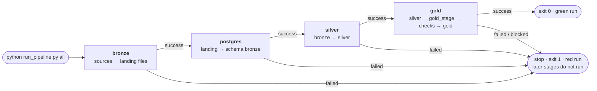
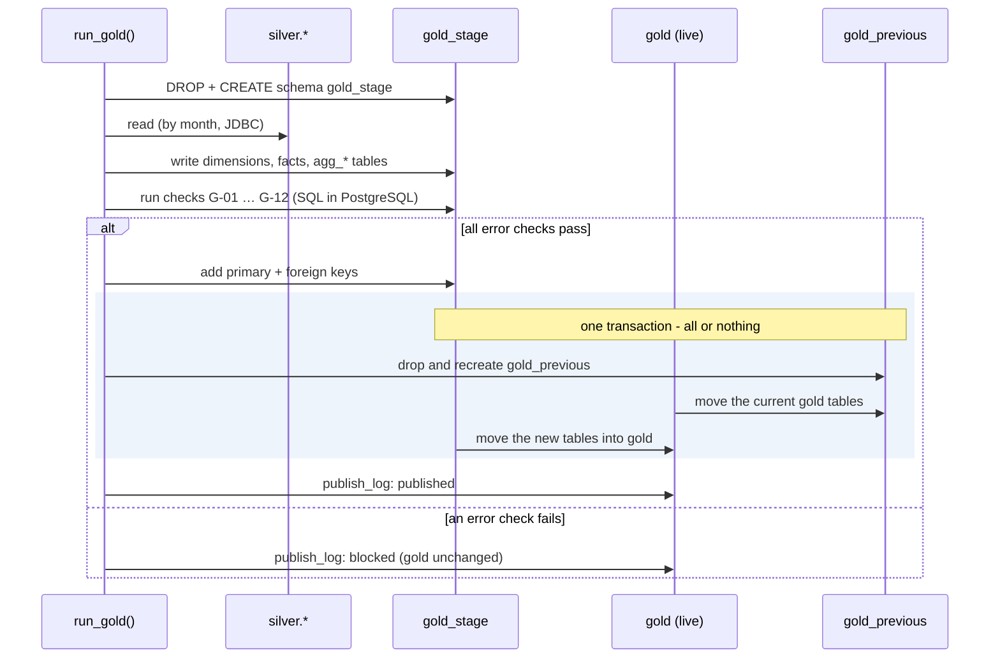
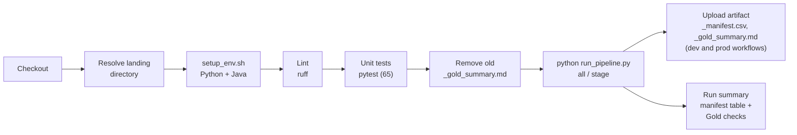
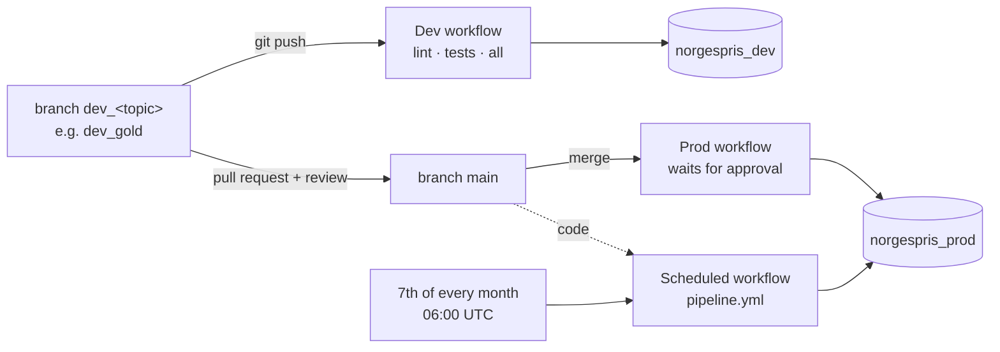

# Pipelines and workflows

How the pipeline runs – by hand and in GitHub Actions – how to monitor it, and what to do when something fails.
Installation: [setup.md](setup.md) · design: [architecture.md](architecture.md) · checks: [data-quality.md](data-quality.md).

## Contents
1. [Overview](#1-overview)
2. [Running by hand](#2-running-by-hand)
3. [The four stages](#3-the-four-stages)
4. [The orchestrator `run_pipeline.py`](#4-the-orchestrator-run_pipelinepy)
5. [GitHub Actions workflows](#5-github-actions-workflows)
6. [Branches and releases](#6-branches-and-releases)
7. [Recovery and reruns](#7-recovery-and-reruns)
8. [Monitoring – where to look](#8-monitoring--where-to-look)
9. [Changing the code](#9-changing-the-code)

---

## 1. Overview



Each stage is one Python function with the same contract: it returns `{"status": "success" | "failed", "elapsed_time": …, …}`.
The orchestrator runs the stages in order and **stops at the first failure**, so a later layer is never built from a failed earlier one.

## 2. Running by hand

```bash
source ~/spark-env/bin/activate                 # once per terminal
cd ~/dat535-group24

python run_pipeline.py all                      # bronze -> postgres -> silver -> gold (dev by default)
python run_pipeline.py bronze                   # only download new raw files into the landing folder
NORGESPRIS_LOAD_MODE=full python run_pipeline.py all  # whole files instead of only the newest month (default: delta)
python run_pipeline.py postgres                 # only (re)load landing files into the bronze schema
python run_pipeline.py silver                   # only rebuild silver from bronze
python run_pipeline.py gold                     # only rebuild, check and publish gold from silver
NORGESPRIS_ENV=prod python run_pipeline.py all  # the same in prod (landing .../prod, database norgespris_prod)
```

Or run the notebooks `01_bronze` → `02_silver` → `03_gold`: they call the same functions (`run_bronze()`, `run_silver()`, `run_gold()`)
and show the results.

## 3. The four stages

| Stage | Reads | Writes | Re-run behaviour | Fails when | Typical time (full period) |
|---|---|---|---|---|---|
| **bronze** (`bronze_pipeline.run_bronze`) | Elhub, SSB, Frost APIs; `_manual/` folder | files in `/tmp/norgespris-landing/<env>/`, `_manifest.csv` | files with a known checksum are skipped; the newest 2 Frost months are fetched again; **delta:** only the newest month of the time series (below) | a **required** source cannot be downloaded (optional ones only warn) | 5–20 min (first run), minutes after |
| **postgres** (`bronze_to_postgres.run_bronze_to_postgres`) | newest landing files + manifest | `bronze.<dataset>`, `bronze.manifest`, `bronze._load_log`, `bronze._load_files` | a table is only reloaded when its landing files changed (fingerprint); **delta:** new month files are appended (`bronze._load_files`) | a required dataset cannot be loaded; password missing | 2–10 min |
| **silver** (`silver_pipeline.run_silver`) | `bronze.*` | `silver.*`, `silver.rejects` (replaced), `silver.quality_metrics` (appended) | full rebuild | required Bronze table missing; **duplicate keys > 0** | ≈ 10 min |
| **gold** (`gold_pipeline.run_gold`) | `silver.*` | `gold_stage.*` → `gold.*` (+ `gold_previous.*`), `gold.publish_log`, `gold.check_results`, `_gold_summary.md` | full rebuild; published only if all error checks pass | required Silver table missing; an **error check** fails; publishing fails | ≈ 1.5 min |

**Period:** Frost downloads and all Silver tables cover `NORGESPRIS_<ENV>_START_MONTH` … `_END_MONTH` (empty end = last complete month).

### Full and delta load

`NORGESPRIS_LOAD_MODE` (`.env` or repository variable) decides how much is downloaded and loaded:

| | `delta` (default) | `full` |
|---|---|---|
| First run (nothing in landing for a dataset) | full files | full files |
| Later runs – Elhub consumption, Norgespris counts | only the **newest complete month**: Elhub's month file on data.elhub.no (`…-all-en-2026-10-00.csv`) | the whole file again (~3 years for consumption) |
| Later runs – Frost observations | only the newest month(s) | every month of the period that is missing + the 2 newest |
| SSB population, Norgespris per price area, Frost station lists | full file (small; unchanged → skipped by checksum) | full file |
| `postgres` stage, time-series tables | new month files are **appended** (`bronze._load_files` records what is in each table) | table replaced when its files changed |
| Silver, Gold | full rebuild from Bronze (unchanged) | full rebuild |

**Which months a delta run loads** – a *high-water mark* read from the manifest: the newest month already in landing (a month file
covers its month; a full file covers up to the month before the day it was downloaded). The run loads every month from that month to
the end of the period, and at least the last `NORGESPRIS_DELTA_MONTHS` (default 1). So the high-water month is loaded once more (Elhub
and MET correct recent data), and if the pipeline did not run for a while, the missing months are filled in automatically.

**Safety nets** (the run stays green, the manifest shows a `warning: …` row):
* month file missing (HTTP 400/404, e.g. before Elhub publishes it on the 6th) → the full file is downloaded instead;
* month file with **other columns** than the full file → not stored (two layouts in one Bronze table would break Silver) → full file instead;
* a new **full** file in landing (e.g. after `/tmp` was cleaned) → the Bronze table is **replaced**, never appended to.

Why Silver and Gold stay full rebuilds: they are small after the daily aggregation (minutes), the temperature model needs the whole
before-period anyway, and Silver already keeps only the newest version per key – so a month that was loaded twice into Bronze
(original + correction) gives exactly one row in Silver.

**Gold publishing step by step:**



## 4. The orchestrator `run_pipeline.py`

| | |
|---|---|
| Usage | `python run_pipeline.py {bronze,postgres,silver,gold,all}` |
| Order | `STAGES = {"bronze", "postgres", "silver", "gold"}` – `all` runs them in this order |
| Exit code | `0` = every stage `success`; `1` = a stage failed or crashed (the workflow run turns red) |
| Logging | `time - logger - level - message` on stdout (visible in the Actions log); loggers `bronze`, `postgres`, `silver`, `gold`, `run_pipeline` |
| Adding a stage | write `run_<layer>()` returning the same dict, add it to `STAGES`, add it to the `stage` options of `norgespris-prod.yml` |

## 5. GitHub Actions workflows

All three workflows run on the **self-hosted runner** (your machine, see [setup.md §9](setup.md#9-github-actions-runner)).

| Workflow | Trigger | GitHub environment | Env | Runs | Concurrency |
|---|---|---|---|---|---|
| `norgespris-dev.yml` – *Dev Pipeline* | push to any `dev_*` branch (`dev_silver`, `dev_gold`, …); manual | `dev` | dev | lint → tests → `all` | group `norgespris-dev` |
| `norgespris-prod.yml` – *Production Pipeline* | push to `main` (after a reviewed PR); manual with a **stage** choice (`all`, `bronze`, `postgres`, `silver`, `gold`) | `main` (required reviewers → approval click) | prod | lint → tests → chosen stage | group `norgespris-prod` |
| `pipeline.yml` – *Pipeline* (scheduled) | **monthly, 7th at 06:00 UTC** (`0 6 7 * *` – Elhub publishes last month's file on the 6th); manual | `main` | prod | lint → tests → `all` | group `norgespris-prod` (never overlaps prod) |

**Steps of every workflow:**



The last two steps run **also when the pipeline failed** (`if: always()`), so the evidence of a failed run is always on the run page.
A failing lint or test stops the workflow **before** any data is touched.

**Secrets and variables used by the workflows:**

| Name | Kind | Used for |
|---|---|---|
| `FROST_CLIENT_ID` | secret | Frost API |
| `NORGESPRIS_PG_PASSWORD` | secret | PostgreSQL |
| `NORGESPRIS_DEV_START_MONTH`, `_END_MONTH`, `NORGESPRIS_PROD_START_MONTH`, `_END_MONTH` | variables | period (defaults in each workflow) |
| `NORGESPRIS_LOAD_MODE` | variable | `delta` (default) or `full` – see [§3](#full-and-delta-load) |
| `NORGESPRIS_PG_HOST`, `_PORT`, `_USER` | variables | PostgreSQL connection (default `localhost`, `5432`, `norgespris`) |
| `NORGESPRIS_SPARK_DRIVER_MEMORY` | variable | Spark heap (default `2g`) |
| `SPARK_LOCAL_IP=127.0.0.1` | set in the workflow files | Spark networking on a runner service |

**Security:** `permissions: contents: read`; no `pull_request` trigger (public repo + self-hosted runner); prod needs an approval.

**Missed schedule:** a scheduled run only starts if the runner is online. If the machine was off on the 7th, start *Actions → Pipeline →
Run workflow* by hand.

## 6. Branches and releases



1. Work on a `dev_<topic>` branch (`dev_silver`, `dev_gold`, …). Every push runs the **dev** workflow (dev database and folder only).
2. When dev is green: open a **pull request** `dev_<topic> → main`, review it, merge.
3. The merge runs the **prod** workflow; it waits for an approval (environment `main`) and then writes to `norgespris_prod`.
4. The scheduled workflow refreshes prod every month from `main`.

Commit messages: `type(layer): what` – e.g. `feat(gold): uptake table`, `fix(silver): private split`, `docs: pipelines`.

## 7. Recovery and reruns

| Situation | What to do |
|---|---|
| A source was down (Bronze `failed`) | run again later: `python run_pipeline.py all` – files already stored are skipped |
| Silver failed | fix the cause (see [data-quality.md §7](data-quality.md#7-when-something-fails--runbook)), then `python run_pipeline.py silver` and `gold` |
| Gold `blocked` | nothing is broken – the previous version is still live. Read `gold.check_results` for the run, fix, run `python run_pipeline.py gold` |
| Need an earlier or longer period (backfill) | change `NORGESPRIS_<ENV>_START_MONTH` (`.env` or repository variable), run `all`: Bronze fetches the missing Frost months, Silver/Gold rebuild |
| Landing folder deleted (`/tmp` cleaned) | run `all` – everything is downloaded again (also in delta mode: no manifest = first run); Bronze tables are replaced because a new full file arrived |
| Delta keeps falling back to the full file | read the `warning: …` rows in `_manifest.csv`: month file not published yet (run after the 6th) or other columns (Elhub changed the format – then use `NORGESPRIS_LOAD_MODE=full` until the code is adapted) |
| Force a complete reload | `NORGESPRIS_LOAD_MODE=full python run_pipeline.py all` |
| A published Gold version is wrong | put the previous version back (below), then fix and run `gold` again |

**Roll back Gold to the previous version** (one transaction; run as `norgespris` in `psql`):
```sql
BEGIN;
DO $$
DECLARE t text;
BEGIN
  CREATE SCHEMA IF NOT EXISTS gold_rolled_back;
  FOR t IN SELECT table_name FROM information_schema.tables WHERE table_schema = 'gold_previous' LOOP
    EXECUTE format('DROP TABLE IF EXISTS gold_rolled_back.%I CASCADE', t);
    EXECUTE format('ALTER TABLE IF EXISTS gold.%I SET SCHEMA gold_rolled_back', t);   -- current version out
    EXECUTE format('ALTER TABLE gold_previous.%I SET SCHEMA gold', t);              -- previous version in
  END LOOP;
END $$;
INSERT INTO gold.publish_log (run_id, logged_at, env, status, message)
VALUES (to_char(now() AT TIME ZONE 'UTC', 'YYYYMMDD"T"HH24MISS"Z"'), now()::text, current_database(), 'rolled_back',
        'previous version restored by hand; the replaced version is in gold_rolled_back');
COMMIT;
```
`publish_log` and `check_results` stay in `gold` (they are history, not part of a version).

## 8. Monitoring – where to look

| Question | Where |
|---|---|
| Did the run succeed? | GitHub → *Actions* (green/red); exit code of `run_pipeline.py` |
| What was downloaded? | run page summary (manifest table), artifact `_manifest.csv`, table `bronze.manifest` |
| What was loaded into Bronze? | `bronze._load_log` (per table), `bronze._load_files` (per landing file, `full` / `delta`) |
| How good is Silver, compared with the last run? | `silver.quality_metrics`, `silver.rejects`; notebook 02 §5.2 |
| Is a new Gold version live? Which checks failed? | `gold.publish_log`, `gold.check_results`; run page *Gold run summary*; `_gold_summary.md` in the landing folder |
| How long did each step take? | the run log (each stage logs its time); `run_gold()` returns `timings_s` per table (notebook 03 §9) |
| Is the machine running out of memory? | `sudo dmesg \| grep -i "out of memory"`, `ps -eo pid,rss,comm --sort=-rss \| head` |

Ready-made SQL for these: [data-quality.md §6](data-quality.md#6-where-to-look--useful-queries).

## 9. Changing the code

1. Change the code **in the notebook** cell (it explains the code), then copy the same cell into the matching `.py` file:

   | Notebook | Sections | Pipeline file |
   |---|---|---|
   | `01_bronze.ipynb` | 3.1–3.9 | `bronze_pipeline.py` |
   | `01_bronze.ipynb` | 4.1, 4.2, 4.5, 5.1–5.2 | `bronze_to_postgres.py` |
   | `02_silver.ipynb` | 2, 4–5.1 | `silver_pipeline.py` |
   | `03_gold.ipynb` | 2, 4–7.1 | `gold_pipeline.py` |

2. Add or update a test in `tests/` (they run without a database).
3. `ruff check --select E9,F63,F7,F82 . && pytest -q tests/` locally.
4. Push to a `dev_*` branch → the dev workflow runs everything against `norgespris_dev`.
5. Pull request → review → merge to `main` → prod.
